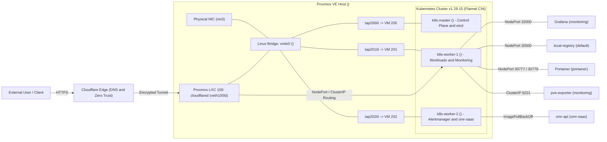

# Current Infrastructure Topology

> **Last Audited:** 2026-11-26  
> **Sanitization Status:** Verified against the Zero Leak Policy (`GEMINI.md`). All real IPv4/IPv6 addresses, link-local MAC-derived identifiers, internal cluster IPs, and private network identifiers have been replaced with standardized placeholders.

## Architecture Overview

The homelab runs on a single physical **Proxmox VE** host (`<PROXMOX_NODE_IP>`) backed by a `476.9 GB` disk partitioned with LVM-thin (`local-lvm`) and directory storage (`local`). External traffic enters through a **Cloudflare Tunnel** running inside a lightweight LXC container (`cloudflared`, VMID `100`), which communicates over Linux bridge `vmbr0` (`<INTERNAL_SUBNET>`) with a virtualized **3-node Kubernetes (`v1.29.15`) cluster** (`k8s-master`, `k8s-worker-1`, `k8s-worker-2`).

At the time of this audit, **no Kubernetes Ingress Controller or Ingress resource** is deployed. Services are exposed internally via `ClusterIP` or directly on node ports via `NodePort`.

---

## Sanitized Infrastructure Inventory

### 1. Proxmox VE Compute (VMs & LXC Containers)

| Type | VMID | Name | Status | Memory | Disk / Bootdisk | Notes |
| :--- | :--- | :--- | :--- | :--- | :--- | :--- |
| **LXC** | `100` | `cloudflared` | `running` | — | `2 GB` (`pve-vm--100--disk--0`) | Cloudflare Tunnel connector attached via `veth100i0` |
| **VM** | `200` | `k8s-master` | `running` | `4096 MB` | `50.20 GB` (+ `4M` cloud-init) | Kubernetes control plane (`tap200i0`) |
| **VM** | `201` | `k8s-worker-1` | `running` | `3072 MB` | `50.20 GB` (+ `4M` cloud-init) | Primary worker node (`tap201i0`) |
| **VM** | `202` | `k8s-worker-2` | `running` | `2048 MB` | `50.20 GB` (+ `4M` cloud-init) | Secondary worker node (`tap202i0`) |
| **VM** | `9000` | `ubuntu-2204-template` | `stopped` | `2048 MB` | `2.20 GB` | Base Ubuntu 22.04 cloud-init template |

### 2. Proxmox VE Storage & Networking

- **Physical Disk (`sda`, `476.9 GB`):**
  - `sda1` (`1007 KB`): BIOS boot partition
  - `sda2` (`1 GB`): EFI system partition (`/boot/efi`)
  - `sda3` (`475.9 GB` LVM):
    - `pve-swap` (`8 GB`): Host swap
    - `pve-root` (`96 GB`): Proxmox OS root (`/`)
    - `pve-data-tpool` (`348.8 GB`, plus `3.6 GB` `pve-data_tmeta`): LVM-thin pool hosting VM and LXC virtual disks
- **Proxmox Storage Pools:**
  - `local` (`dir`, active): ~`93.9 GiB` total, ~`4.7 GiB` used (`5.02%`), ~`84.4 GiB` available
  - `local-lvm` (`lvmthin`, active): ~`348.8 GiB` total, ~`62.5 GiB` used (`17.92%`), ~`286.3 GiB` available
- **Host Networking:**
  - `vmbr0` (`UP`): Bridge configured with `<PROXMOX_NODE_IP>/24` on `<INTERNAL_SUBNET>` and `<PROXMOX_LINK_LOCAL_IPV6>`, bridging `nic0` (`UP`), `veth100i0` (`UP`), `tap200i0`, `tap201i0`, and `tap202i0`.
  - `wlp2s0`: `DOWN` (unused wireless interface).
  - `lo`: `<LOOPBACK>` interface.

### 3. Kubernetes Cluster Nodes

- **Cluster Context:** `kubernetes-admin@kubernetes` (Kubernetes `v1.29.15`, age `236d`)
- **OS / Runtime:** `Ubuntu 22.04.5 LTS`, kernel `5.15.0-204-generic`, `containerd://2.2.1`
- **CNI:** Flannel (`kube-flannel-ds` DaemonSet across all 3 nodes)
- **Default StorageClass:** `local-path` (`rancher.io/local-path`, Reclaim Policy: `Delete`, Volume Binding: `WaitForFirstConsumer`)

| Node | Role | Status | Internal IP | External IP |
| :--- | :--- | :--- | :--- | :--- |
| `k8s-master` | `control-plane` | `Ready` | `<K8S_MASTER_IP>` | `<none>` |
| `k8s-worker-1` | `worker` (`<none>`) | `Ready` | `<K8S_WORKER_01_IP>` | `<none>` |
| `k8s-worker-2` | `worker` (`<none>`) | `Ready` | `<K8S_WORKER_02_IP>` | `<none>` |

### 4. Kubernetes Namespaces, Workloads & Services

| Namespace | Workload / Component | Node(s) | Status / Notes | Exposed Service & Ports |
| :--- | :--- | :--- | :--- | :--- |
| `kube-system` | `etcd`, `kube-apiserver`, `kube-controller-manager`, `kube-scheduler`, `coredns` (x2) | `k8s-master` | `Running` | `kubernetes` (`ClusterIP 443/TCP`), `kube-dns` (`ClusterIP 53/UDP,53/TCP,9153/TCP`) |
| `kube-system` | `kube-proxy` (DaemonSet) | All 3 nodes | `Running` | Headless metric endpoints (`kube-prom-stack-*`) |
| `kube-flannel` | `kube-flannel-ds` (DaemonSet) | All 3 nodes | `Running` | Pod overlay network (`<POD_CIDR>`) |
| `local-path-storage` | `local-path-provisioner` | `k8s-worker-1` | `Running` | Dynamic local PV provisioning |
| `default` | `local-registry` | `k8s-worker-1` | `Running` | `local-registry-service` (`NodePort 5000:30500/TCP`) |
| `default` | `httpd`, `nginx-1` | `k8s-worker-1` | `Running` | No dedicated Ingress; `mymysql` (`ClusterIP 80/TCP`) also present |
| `monitoring` | `kube-prom-stack` (Operator, Prometheus, Grafana, `kube-state-metrics`) | `k8s-worker-1` | `Running` | `kube-prom-stack-grafana` (`NodePort 80:32000/TCP`), Prometheus (`ClusterIP 9090/TCP`) |
| `monitoring` | `alertmanager` | `k8s-worker-2` | `Running` | `kube-prom-stack-kube-prome-alertmanager` (`ClusterIP 9093/TCP,8080/TCP`) |
| `monitoring` | `prometheus-node-exporter` (DaemonSet) | All 3 nodes | `Running` | `ClusterIP 9100/TCP` |
| `monitoring` | `pve-exporter` | — | Service active | `pve-exporter` (`ClusterIP 9221/TCP`) |
| `portainer` | `portainer` | `k8s-worker-1` | `Running` | `portainer` (`NodePort 9000:30777/TCP, 9443:30779/TCP, 30776:30776/TCP`) |
| `omr-saas` | `omr-api` | `k8s-worker-2` | `0/1 ImagePullBackOff` | `omr-api-service` (`ClusterIP 80/TCP`) |
| `backend`, `nginx` | — | — | `Active` (empty) | No running pods or services |

> **Operational Observation:** Most scheduled workloads across `k8s-worker-1`, `k8s-worker-2`, and `k8s-master` showed synchronized restarts ~9 minutes prior to this scan, consistent with a recent host or cluster reboot.

---

## Educational Breakdown

1. **Hypervisor & Virtualization Layer (Proxmox VE):** Proxmox isolates workloads at the kernel/OS level. `cloudflared` runs in an LXC container (`VMID 100`) because it only needs a lightweight Linux user space to maintain an outbound tunnel, whereas the Kubernetes nodes (`VMID 200–202`) run as full KVM virtual machines cloned from `ubuntu-2204-template` (`VMID 9000`) so each node gets its own kernel, `containerd` runtime, and `iptables`/Flannel networking.
2. **Bridged Networking (`vmbr0`):** Proxmox connects the physical NIC (`nic0`), the LXC `veth100i0`, and the VM `tap` interfaces onto `vmbr0`, allowing `cloudflared` and all three Kubernetes VMs to sit on the same Layer-2 `<INTERNAL_SUBNET>` broadcast domain.
3. **Kubernetes Scheduling Skew:** Notice `k8s-worker-1` (`3072 MB` RAM) runs most workloads (Prometheus, Grafana, `local-registry`, Portainer, `local-path-provisioner`, `httpd`, `nginx-1`), while `k8s-worker-2` (`2048 MB` RAM) hosts Alertmanager and the failing `omr-api` pod.

---

## How It Works & Key Concepts

- **Why Proxmox LXC + KVM VMs Together?** Using LXC for lightweight network appliances (`cloudflared`) minimizes RAM/CPU overhead on a single host, while KVM VMs provide full kernel isolation required by Kubernetes (`cgroups`, `overlayfs`, `br_netfilter`).
- **Why Flannel CNI?** Flannel provides a simple VXLAN overlay network (`<POD_CIDR>`) across VMs with minimal configuration overhead, making it ideal for learning Kubernetes pod-to-pod routing before adopting more advanced CNIs like Cilium.
- **Why Cloudflare Tunnel Instead of Port Forwarding?** `cloudflared` initiates outbound-only encrypted connections from LXC `100` to Cloudflare Edge, exposing internal services without opening inbound ports on the home router or revealing the residential public IP.
- **Why `kube-prom-stack` + `pve-exporter`?** Combining Kubernetes metrics (`node-exporter`, `kube-state-metrics`) with Proxmox metrics (`pve-exporter`) gives end-to-end visibility from physical host disk/memory down to individual container restarts.
